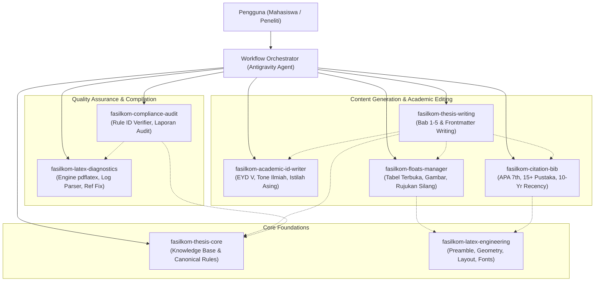

# Skills Architecture: Fasilkom UNEJ LaTeX Thesis System

Dokumen ini mendefinisikan arsitektur modular, alur kerja (workflow), hierarki, serta interaksi antar-skill dalam ekosistem **Antigravity AI Agent** untuk penyusunan, penyuntingan, dan audit kepatuhan skripsi berbasis LaTeX.

---

## 1. Diagram Arsitektur Sistem Skills



---

## 2. Rincian Modul Skill

Sistem dibangun atas **8 modular skills** yang memiliki pembagian tanggung jawab (*separation of concerns*) yang tegas:

### 1. `fasilkom-thesis-core`
- **Tanggung Jawab:** Single source of truth untuk seluruh aturan Juknis Versi 2.0 (2023), prioritas pedoman, ruang lingkup bidang minat Fasilkom, dan batasan kepatuhan akademik.
- **Kapan Digunakan:** Ketika agent membutuhkan rujukan aturan resmi, interpretasi bab/pasal juknis, atau validasi administratif (syarat SKS, kalender, etika plagiasi).
- **File Utama:** `.agents/skills/fasilkom-thesis-core/SKILL.md`
- **Referensi Terkait:** `.agents/references/CANONICAL_JUKNIS_RULES.md`

### 2. `fasilkom-latex-engineering`
- **Tanggung Jawab:** Manajemen struktur proyek LaTeX, document class `report`, konfigurasi paket (`packages.tex`), geometry margin 4-4-3-3 cm, font Times New Roman 12pt, pagestyle header/footer (`page-style.tex`), dan custom commands (`custom-commands.tex`).
- **Kapan Digunakan:** Menginisialisasi proyek baru, mengonfigurasi layout halaman, memodifikasi format judul bab/subbab, atau memperbaiki pengaturan spasi dan margin.
- **File Utama:** `.agents/skills/fasilkom-latex-engineering/SKILL.md`

### 3. `fasilkom-thesis-writing`
- **Tanggung Jawab:** Pemandu penulisan naskah Bab 1 s.d. Bab 5, frontmatter (Cover, Persembahan, Orisinalitas, Abstrak, Ringkasan, Prakata), dan backmatter sesuai dengan aspek kecukupan proposal dan laporan skripsi Fasilkom (Tabel 2.34 & 2.35 Juknis).
- **Kapan Digunakan:** Menyusun draf bab baru, mengembangkan kerangka latar belakang, merumuskan batasan masalah, menyusun ringkasan, atau memastikan kelengkapan struktur bab.
- **File Utama:** `.agents/skills/fasilkom-thesis-writing/SKILL.md`

### 4. `fasilkom-academic-id-writer`
- **Tanggung Jawab:** Penegakan kaidah tata bahasa Indonesia formal sesuai EYD Versi 5, gaya penulisan objektif dan kritis, konsistensi terminologi komputasi, pemformatan cetak miring (*italic*) pada istilah asing, dan penghindaran kata ganti orang pertama informal.
- **Kapan Digunakan:** Memoles (*proofreading*) narasi skripsi, menyunting kalimat yang canggung, menerjemahkan abstrak ke Inggris akademik, dan memformat istilah teknis.
- **File Utama:** `.agents/skills/fasilkom-academic-id-writer/SKILL.md`

### 5. `fasilkom-citation-bib`
- **Tanggung Jawab:** Pengelolaan basis data bibliografi BibTeX (`.bib`), penegakan gaya APA 7th edition, validasi batas minimal 15 pustaka, verifikasi minimal 3 jurnal internasional/Sinta 1-2, dan verifikasi rasio minimal 50% publikasi 10 tahun terakhir.
- **Kapan Digunakan:** Menambahkan entri referensi baru, memformat sitasi dalam teks (`\citep` vs `\citet`), membersihkan entri `.bib`, dan mengaudit kemutakhiran referensi.
- **File Utama:** `.agents/skills/fasilkom-citation-bib/SKILL.md`

### 6. `fasilkom-floats-manager`
- **Tanggung Jawab:** Pembuatan dan penataan elemen mengapung (tabel, gambar, persamaan matematika, algoritma) sesuai aturan: posisi tengah, format tabel terbuka (*open table* tanpa garis vertikal), judul tabel di atas 11pt, judul gambar di bawah 11pt, serta kewajiban perujukan dalam teks (*Title Case*).
- **Kapan Digunakan:** Menyisipkan tabel komparasi hasil, bagan arsitektur sistem, flowchart metodologi, atau memperbaiki peringatan posisi float.
- **File Utama:** `.agents/skills/fasilkom-floats-manager/SKILL.md`

### 7. `fasilkom-compliance-audit`
- **Tanggung Jawab:** Melakukan audit menyeluruh terhadap kepatuhan naskah skripsi berdasarkan 41 Rule ID resmi Juknis Fasilkom, menjalankan skrip audit otomatis, dan menerbitkan laporan temuan ketidaksesuaian (*compliance report*).
- **Kapan Digunakan:** Sebelum seminar proposal, sebelum pendaftaran ujian skripsi, atau saat melakukan *quality check* akhir dokumen.
- **File Utama:** `.agents/skills/fasilkom-compliance-audit/SKILL.md`

### 8. `fasilkom-latex-diagnostics`
- **Tanggung Jawab:** Orkestrasi proses kompilasi (`pdflatex`, `bibtex`, `latexmk`), membaca dan mengurai log kompilasi, mendeteksi warning "Reference undefined" atau "Citation undefined", serta menyelesaikan error sintaks TeX.
- **Kapan Digunakan:** Ketika proses build dokumen gagal, terjadi overflow/underflow box ekstrem, atau terdapat referensi silang yang rusak (*broken links*).
- **File Utama:** `.agents/skills/fasilkom-latex-diagnostics/SKILL.md`

---

## 3. Alur Kerja Standar (Workflow Lifecycle)

Agent merespons instruksi pengguna melalui salah satu dari 4 alur kerja utama:

```
[1. SCAFFOLDING] --> Inisialisasi struktur berkas & template
       |
[2. AUTHORING]   --> Menulis konten bab, tabel, gambar, & sitasi
       |
[3. AUDITING]    --> Menjalankan skrip validasi kepatuhan Rule ID
       |
[4. DIAGNOSTICS] --> Kompilasi dokumen, perbaikan log, & verifikasi PDF final
```

### Alur 1: Penulisan Bab Baru
1. Agent membaca `fasilkom-thesis-writing` untuk memahami struktur wajib subbab.
2. Jika ada tabel/gambar, agent memanggil konvensi `fasilkom-floats-manager`.
3. Jika ada pengutipan, agent menggunakan panduan `fasilkom-citation-bib`.
4. Agent menerapkan kaidah `fasilkom-academic-id-writer` untuk memastikan EYD V dan istilah miring.

### Alur 2: Audit Pra-Ujian
1. Agent mengaktifkan `fasilkom-compliance-audit`.
2. Menjalankan skrip validasi `.agents/scripts/validate_thesis.py`.
3. Memeriksa rasio referensi 10 tahun terakhir dan batas kata abstrak.
4. Menghasilkan laporan audit dengan pemetaan langsung ke Rule ID.

### Alur 3: Penyelesaian Masalah Kompilasi (Build & Fix)
1. Agent mengaktifkan `fasilkom-latex-diagnostics`.
2. Menjalankan kompilasi terisolasi: `pdflatex -> bibtex -> pdflatex -> pdflatex`.
3. Memeriksa file `.log` dan `.blg` untuk menangkap entri yang belum terselesaikan.
4. Menerapkan perbaikan minim risiko pada berkas TeX terkait.

### Alur 4: Pengendalian Kuota 40 Halaman & Pencegahan Pembahasan Ganda (`RULE-PAG-08`)
1. Agent menghitung alokasi halaman per bab dari hasil kompilasi.
2. Jika kuota Bab 4 (> 20 halaman) atau total Bagian Utama (> 40 halaman) terancam terlampaui, agent menerbitkan **WARNING** deskriptif.
3. **Strict Zero-Text-Mutation Policy:** Agent secara mutlak DILARANG mengubah atau memotong teks eksisting naskah secara sepihak.
4. Agent memindai naskah untuk mendeteksi paragraf yang pembahasannya ganda (*double discussion*) antar-bab (misal pengulangan teori Bab 2 di Bab 4 atau pengulangan prosedur langkah Bab 3 di Bab 4) dan menyajikan saran peringkasan berbasis rujukan silang.
5. Agent mengidentifikasi tabel matriks masif atau gambar antarmuka non-inti, lalu mengajukan usulan pemindahan ke **Lampiran (Backmatter)** yang dieksekusi **HANYA SETELAH memperoleh persetujuan eksplisit dari pengguna**.

---

## 4. Mekanisme Progressive Disclosure

Untuk menghemat context window model dan mencegah token bloat:
1. Agent hanya memuat ringkasan nama dan deskripsi skill saat startup.
2. Ketika workflow tertentu aktif (misal pembuatan tabel), agent hanya memuat file `fasilkom-floats-manager/SKILL.md`.
3. Dokumen tebal Juknis tidak dimuat berulang-ulang, melainkan dirujuk secara presisi ke `.agents/references/CANONICAL_JUKNIS_RULES.md`.
